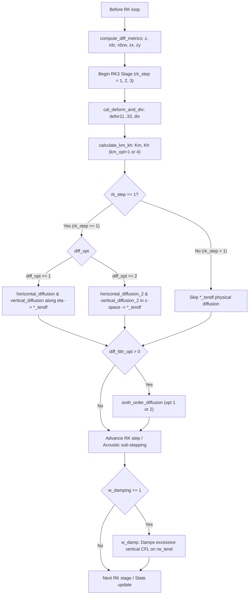

# WRF v4.6.1 Diffusion and Damping in CPPWRF

This directory implements the diffusion, deformation, eddy viscosity, and damping kernels ported from WRF v4.6.1 (`dyn_em/module_diffusion_em.F` and `dyn_em/module_big_step_utilities_em.F`) into modern C++20 with single-source execution semantics (CPU/OpenMP and GPU via `core/backend.hpp`).

## Structure and Kernels

| Source File | WRF Subroutine(s) | WRF File & Lines | Description | RK3 Stage / Calling Point |
|-------------|-------------------|------------------|-------------|---------------------------|
| `diff_metrics.hpp` | `compute_diff_metrics` | `module_diffusion_em.F` (6882–7130) | Computes vertical physical heights ($z$), layer thickness inverses ($rdz, rdzw$), and coordinate metric slopes ($z_x, z_y$) | RK step setup / grid update before deformation |
| `deform_div.hpp` | `cal_deform_and_div` | `module_diffusion_em.F` (17–1190) | Computes 3D deformation tensor ($D_{11}, D_{22}, D_{33}, D_{12}, D_{13}, D_{23}$) and divergence ($\nabla \cdot \mathbf{V}$) with terrain metric slopes and map factors | Before turbulence closure (`calculate_km_kh`) in RK loop |
| `km_kh.hpp` | `calculate_km_kh` | `module_diffusion_em.F` (1192–1800) | Computes eddy viscosity and diffusivity ($K_m, K_h$) for `km_opt=1` (isotropic 3D Smagorinsky) and `km_opt=4` (2D horizontal Smagorinsky with `diff_opt=2` terrain slope $\alpha$ reduction) | Turbulence closure step before tendency diffusion evaluation |
| `diffusion_2.hpp` | `horizontal_diffusion_2`, `vertical_diffusion_2`, `cal_titau_*` | `module_diffusion_em.F` (1805–3700) | Full physical diffusion in terrain-following coordinates (`diff_opt=2`) for $u, v, w, \theta$, scalars, using stress tensor $\tau_{ij}$ | Within `rk_tendency` in RK step |
| `big_step_diffusion.hpp` | `horizontal_diffusion`, `vertical_diffusion`, `*_mp`, `*_3dmp` | `module_big_step_utilities_em.F` (2715–3581) | Coordinate-surface horizontal and vertical diffusion (`diff_opt=1`) for $u, v, w, \theta$, scalars with hybrid vertical coordinates $c_1, c_2$ | Within `rk_tendency` in RK step |
| `sixth_order.hpp` | `sixth_order_diffusion` | `module_diffusion_em.F` (6114–6440) | 6th-order numerical diffusion for $u, v, w, \theta$, scalars (`diff_6th_opt=1` linear, `diff_6th_opt=2` monotonic flux-limited) | Within `rk_tendency` in RK step |
| `w_damp.hpp` | `w_damp` | `module_big_step_utilities_em.F` (2503–2711) | Vertical velocity acoustic/convective damping when vertical CFL exceeds threshold ($w\_damp\_on$) | End of RK sub-step / big step update |

---

## Detailed Kernel Specifications

### 1. `compute_diff_metrics`
- **WRF Reference:** `module_diffusion_em.F:6882`
- **Inputs:** `ph` (perturbation geopotential), `phb` (base-state geopotential), `rdx`, `rdy`.
- **Outputs:** `z` (physical height $z = (ph + phb)/g$), `rdz` (inverse level distance at full levels), `rdzw` (inverse layer thickness at half levels), `zx` ($\partial z / \partial x$), `zy` ($\partial z / \partial y$).
- **Boundary Handling:** Supports periodic boundaries (wrapping across domain edges) and specified boundaries (clamping slopes at boundaries).

### 2. `cal_deform_and_div`
- **WRF Reference:** `module_diffusion_em.F:17`
- **Inputs:** `u, v, w` (velocities), `div` (input div), `zx, zy, rdz, rdzw`, map factors (`msfux, msfuy, msfvx, msfvy, msftx, msfty`), `c1z, c2z` vertical hybrid coefficients, `rdx, rdy`.
- **Outputs:** `defor11, defor22, defor33` (normal deformation components), `defor12, defor13, defor23` (shear deformation components), `div` (divergence).
- **Edge Conditions:** Handles periodic wrapping and specified boundary edge copying.

### 3. `calculate_km_kh`
- **WRF Reference:** `module_diffusion_em.F:1192`
- **Options Supported:**
  - `km_opt = 1`: Isotropic 3D Smagorinsky turbulence closure:
    $$\Delta = (\Delta x \cdot \Delta y \cdot \Delta z)^{1/3}$$
    $$K_m = C_s^2 \Delta^2 \max\left(0, \text{def2} - \frac{N^2}{Pr}\right)^{1/2}$$
    $$K_h = Pr^{-1} K_m$$
  - `km_opt = 4`: 2D horizontal Smagorinsky turbulence closure:
    $$\Delta = \sqrt{\Delta x \cdot \Delta y}$$
    $$K_m = C_s^2 \Delta^2 \sqrt{D_{11}^2 + D_{22}^2 + \frac{1}{2} D_{12}^2}$$
    When `diff_opt == 2`, includes terrain slope $\alpha$ correction factor:
    $$\alpha = \frac{\Delta x^2 + \Delta y^2}{\Delta x^2 + \Delta y^2 + z_x^2 \Delta x^2 + z_y^2 \Delta y^2}$$
    $$K_{m,\text{corrected}} = \alpha \cdot K_m$$

### 4. `horizontal_diffusion_2` & `vertical_diffusion_2`
- **WRF Reference:** `module_diffusion_em.F:1805`
- **Equations:** Full physical diffusion in Cartesian $z$-coordinates transformed to generalized terrain-following coordinate $\eta$:
  $$\tau_{ij} = K_m D_{ij}, \quad H_j = K_h \partial \theta / \partial x_j$$
  Accounts for metric cross-terms involving $z_x$ and $z_y$, full map scale factor tensor transformations, and hybrid coordinate factors $c_1, c_2$.
- **Components:** Separate optimized kernels for $u$-momentum, $v$-momentum, $w$-momentum, and scalars ($\theta$, moisture/tracers).

### 5. `horizontal_diffusion` & `vertical_diffusion` (diff_opt = 1)
- **WRF Reference:** `module_big_step_utilities_em.F:2715–3581`
- **Equations:** Diffusion along coordinate surfaces:
  $$\nabla \cdot (K \nabla \phi)$$
  Includes map scale factors, hybrid coordinate factors $(c_1 \mu_t + c_2)$, and distinct staggering treatments for $u, v, w$, and cell-centered scalars.

### 6. `sixth_order_diffusion`
- **WRF Reference:** `module_diffusion_em.F:6114`
- **Options Supported:**
  - `diff_6th_opt = 1`: Standard 6th-order linear numerical hyper-diffusion:
    $$\text{flux}_i = \frac{1}{60} (c_1 \mu + c_2) \left[ 10 (\phi_{i+1} - \phi_i) - 5 (\phi_{i+2} - \phi_{i-1}) + (\phi_{i+3} - \phi_{i-2}) \right]$$
  - `diff_6th_opt = 2`: Monotonic flux-limited 6th-order numerical diffusion to prevent overshoots and spurious extrema near sharp gradients.

### 7. `w_damp`
- **WRF Reference:** `module_big_step_utilities_em.F:2503`
- **Equation:**
  $$CFL_{vert} = \left| \frac{\omega}{c_1 \mu_t + c_2} \cdot \frac{1}{\Delta \eta} \Delta t \right|$$
  If $CFL_{vert} > w\_damp\_on$ and $w\_damping == 1$:
  $$\partial_t (\mu w) \mathrel{-}= \text{sgn}(w) \cdot w_\alpha \cdot (CFL_{vert} - w\_crit\_cfl) \cdot (c_1 \mu_t + c_2)$$
  Also computes domain maximum vertical and horizontal CFL numbers for model stability diagnostics.

---

## RK3 Time Integration Calling Flow

In the WRF Advanced Research WRF (ARW) solver (`solve_em.F`):

### RK Stage Calling Details
- **`compute_diff_metrics`:** Called before entering the RK loop whenever physical heights or dry air mass change.
- **`cal_deform_and_div` & `calculate_km_kh`:** Evaluated at `rk_step == 1` (or each stage if diagnostic turbulence updating is configured) before diffusion tendencies are accumulated.
- **Physical Diffusion (`*_tendf`):** In WRF ARW (`solve_em.F`), physical diffusion tendencies from `horizontal_diffusion`, `vertical_diffusion`, `horizontal_diffusion_2`, and `vertical_diffusion_2` are accumulated into `ru_tendf`, `rv_tendf`, `rw_tendf`, `t_tendf`, and `scalar_tendf` strictly when `rk_step == 1`. These tendencies are then held constant across the three Runge-Kutta sub-steps.
- **Numerical Diffusion (`sixth_order_diffusion`):** Evaluated inside `rk_tendency` across RK steps.
- **Acoustic/CFL Damping (`w_damp`):** Evaluated inside `rk_update_extra` / big step completion to prevent vertical Courant number blowups.

---

## Input Halo Requirements per Launcher

The following table summarizes the lateral ($x, y$) halo cells required on input for each launcher across subdomains / distributed tiles:

| Launcher Function | Header File | Input Fields Needing Valid Halos | Required Halo Width & Direction | Notes |
|---|---|---|---|---|
| `compute_diff_metrics` | `diff_metrics.hpp` | *None* | Halo 0 | Boundary/periodic conditions handled internally |
| `cal_deform_and_div` | `deform_div.hpp` | `u` `v` `w` `zx` `zy` `rdzw` `rdz` | Halo 1 in Y ($j-1$ for $D_{12}$) Halo 1 in X ($i-1$ for $D_{12}$) Halo 1 in X and Y ($w(i-1)$ in $D_{13}$, $w(j-1)$ in $D_{23}$) Halo 1 in Y ($zx(i, j-1)$) Halo 1 in X ($zy(i-1, j)$) Halo 1 in X and Y ($rdzw(i-1, j-1)$) Halo 1 in X and Y ($rdz(i-1)$ in $D_{13}$, $rdz(j-1)$ in $D_{23}$) | Map factors (`msf*`) pointwise local (Halo 0) |
| `calculate_km_kh` | `km_kh.hpp` | `defor12` `zx` `zy` | Halo 1 on East & North ($i+1, j+1$) Halo 1 on East ($i+1$) Halo 1 on North ($j+1$) | `defor11`, `defor22`, `rdzw`, `msft*` require Halo 0 |
| `horizontal_diffusion_2` | `diffusion_2.hpp` | `thp`, `moist` `rho`, `xkhh`, `xkmh`, `xkmv` `zx` `zy` `rdz`, `rdzw` | Halo 1 in X and Y ($i\pm 1, j\pm 1$ stencils) Halo 1 in X and Y (face/edge averages) Halo 1 on East & South ($zx(i+1, j), zx(i, j-1)$) Halo 1 on North & West ($zy(i, j+1), zy(i-1, j)$) Halo 1 on West & South ($rdz/rdzw(i-1, j), rdzw(i, j-1)$) | `defor*` components local to tile (Halo 0) |
| `vertical_diffusion_2` | `diffusion_2.hpp` | *None* | Halo 0 | Purely 1D vertical columns per $(i, j)$ point |
| `horizontal_diffusion` | `big_step_diffusion.hpp` | `field` ($u, v, w, m$) `xkmhd` `mut` | Halo 1 in X and Y Halo 1 in X and Y Halo 1 in X and Y | 2nd-order Laplacian stencil ($i\pm 1, j\pm 1$); map factors are Halo 0 |
| `horizontal_diffusion_3dmp` | `big_step_diffusion.hpp` | `field`, `base_3d` `xkmhd`, `mut` | Halo 1 in X and Y Halo 1 in X and Y | Same as `horizontal_diffusion` |
| `vertical_diffusion` / `*_mp` | `big_step_diffusion.hpp` | *None* | Halo 0 | Purely 1D vertical columns; `mut` is Halo 0 |
| `vertical_diffusion_u` | `big_step_diffusion.hpp` | `alt` | Halo 1 on West ($alt(i-1, j)$ across $u$-faces) | `field`, `u_base`, `muu` are Halo 0 |
| `vertical_diffusion_v` | `big_step_diffusion.hpp` | `alt` | Halo 1 on South ($alt(i, j-1)$ across $v$-faces) | `field`, `v_base`, `muv` are Halo 0 |
| `sixth_order_diffusion` | `sixth_order.hpp` | `field` ($u, v, w, m$) `mut` | **Halo 3 in X and Y** ($i-3..i+3, j-3..j+3$) Halo 1 in X and Y | Map factors are Halo 0 |
| `w_damp` | `w_damp.hpp` | *None* | Halo 0 | Purely pointwise evaluations across tile |

---

## Precision and Validation

All kernels are implemented with template support for single (`float`) or double (`double`) precision, matching CPPWRF working precision `cppwrf::real`.
Differential validation against reference WRF v4.6.1 Fortran yields:
$$\frac{\| \phi_{\text{C++}} - \phi_{\text{Fortran}} \|_\infty}{\max(1, \| \phi_{\text{Fortran}} \|_\infty)} \le 10^{-14} \quad (\text{well within } 10^{-12} \text{ quality gate})$$
under IEEE 754 floating-point arithmetic without vectorization contraction divergences (`-ffp-contract=off`).
